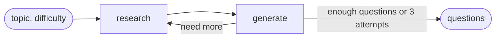

# Trivia

A multiplayer trivia game where the host types any topic and an LLM pipeline writes the questions
from Wikipedia while players wait in the lobby. Every question is grounded in a real article, checked
by a classifier before it's served, and revealed with the quote and link that prove the answer.

```
trivia-backend/   FastAPI server: rooms over REST, gameplay over WebSocket, question generation (LangGraph)
UI/web/           React + Vite + TypeScript web app
Dockerfile        builds the web app and serves it from FastAPI in one container
```

## How a game works

1. **Create a room.** The host picks a name, a topic (free text; `GET /categories` offers 10
   suggestions) and a difficulty. `POST /rooms` returns a 4-letter room code and **starts question
   generation in the background straight away**, so it overlaps with players joining.
2. **Join.** Players open the room's WebSocket with a name. The first player in is the host; if the
   host leaves, the longest-connected player takes over.
3. **Start.** Only the host's `start_game` counts. The room shows a "generating" spinner until the
   background task finishes (often already done). Fewer than 5 good questions sends everyone back to
   the lobby with "Not enough material for that topic. Try something broader." and starts a fresh
   generation attempt.
4. **Rounds.** Each question has a 30 s timer. A round ends when every connected player has answered
   or time runs out (no answer = wrong). The first answer is final. The server then sends the correct
   answer, the supporting quote, the source URL and the scores, waits 4 s, and moves on.
5. **Results.** After the last question everyone gets the final scores. Players who left keep theirs.

```
lobby ──start_game──▶ generating ──≥5 questions──▶ question ⇄ reveal ──last one──▶ results
                          │
                          └──<5 questions──▶ lobby (error message)
```

## Question generation

Questions come from a LangGraph graph in `trivia-backend/app/game/graph/`. It loops
**research → generate** until it has enough questions or has made 3 attempts.



### 1. Research: pick and fetch Wikipedia articles (`nodes.research`, `chains/research.py`)

- A LangChain `create_agent` agent (model `openai/gpt-6-luna`, through TokenRouter) gets two tools from
  the [`wikipedia-mcp`](https://pypi.org/project/wikipedia-mcp/) server: `search_wikipedia` and
  `get_summary`. The server runs per round over stdio via `uvx`, pinned to 2.0.1, through
  `wikipedia_mcp_server.py`, which sets a User-Agent with a contact URL (Wikipedia rate-limits the
  server's default one).
- The agent first decides whether the topic is **broad** ("Space") or **narrow** ("The Office"):
  - broad: one specific subject per article, spread across the whole topic;
  - narrow: the topic's own main article, then its parts (characters, seasons, members, events),
    returning fewer articles rather than padding with loosely related ones.
- Difficulty changes which subjects it picks (household names for easy, enthusiast-level for hard).
- It is capped at 6 tool calls (`ToolCallLimitMiddleware`) and returns exact titles as structured
  output. Titles used in earlier rounds are passed back so retries find new articles.
- The node then fetches each article's **full text** itself (`get_article`), keeping the first
  8,000 characters and dropping stubs under 200.
- **Jev** (TypeSafe's classifier, `chains/judges.py`) scores each page: "Is this a good source for
  trivia on this topic?". Pages below 0.5 are dropped and the best ones are kept.

### 2. Generate: write questions (`nodes.generate`, `chains/generation.py`)

- **One LLM call for all pages**, to stay under the TokenRouter rate limit. Each page is passed as
  `[Source N] title + text`, and the model returns structured `GeneratedQuestion`s: question,
  4 options, correct index, a word-for-word supporting quote, and the source number.
- Normally each page gets up to 2 questions. When there are few pages (narrow topics) each page can
  give up to 4.
- The prompt keeps questions grounded (answers only from the source), steers away from date/year
  questions, and adapts to difficulty.
- Any single invalid question (e.g. duplicate options) is dropped without discarding the rest of
  the batch.
- **Jev verifies every question** against its source: the answer must be supported (≥ 0.8) and no
  other option may also be correct (ambiguity ≤ 0.3). This is the only correctness check, so a
  question Jev can't judge is dropped.
- Near-duplicate questions are removed, and the final list is shuffled so sources aren't grouped.

## Backend

| File | Role |
|------|------|
| `app/main.py` | `create_app(question_source)`. Tests inject canned questions instead of the graph. Serves the built web app from `static/` when present. |
| `app/api/rooms.py` | `POST /rooms`, `GET /rooms` (newest first), `GET /rooms/{code}`. Room creation is rate-limited: 3 per IP per 10 min, 20 per hour overall. |
| `app/api/categories.py` | `GET /categories`: topic suggestions. |
| `app/api/ws.py` | `WS /ws/{room_code}/{player_name}`: parses client messages and broadcasts whatever `Room` returns. |
| `app/api/dto.py` | Request/response models: topic is 2–80 chars, difficulty `easy`/`medium`/`hard`. |
| `app/game/room.py` | `Room`: phase, players, host, questions, answers, scores, timer, all round rules. No sockets in its logic, so it's tested directly. |
| `app/game/registry.py` | In-memory room store. |
| `app/game/graph/` | The question pipeline described above. |

Rooms live **in memory**, so the server runs as a single worker and rooms vanish on restart.

### WebSocket protocol (JSON)

Client → server:

| `type` | Fields |
|--------|--------|
| `start_game` | (host only) |
| `chat` | `text` |
| `submit_answer` | `answer_index` (int 0–3) |

Server → clients:

| `type` | Fields |
|--------|--------|
| `player_joined` / `player_left` | `player`, `players`, `host` |
| `phase` | `phase`: `lobby` · `generating` · `question` · `results` |
| `question` | `index`, `total`, `question`, `options`, `seconds` (no answer) |
| `round_result` | `index`, `correct_index`, `supporting_quote`, `source_url`, `scores` |
| `results` | `scores` |
| `chat` | `player`, `text` |
| `error` | `message` |

Close codes: `4003` origin not allowed, `4004` room not found, `4009` name already taken.

### Security notes

- `correct_index` is never sent before the round's `round_result`.
- Client messages are untrusted: non-JSON or non-object messages are ignored, and only an exact `int`
  in range counts as an answer.
- The WebSocket rejects browser connections whose `Origin` host differs from `Host` (CORS doesn't
  cover WebSockets).
- CORS is only enabled with `DEV=1` (any localhost port plus `null` for `file://`). In production
  the page and API share one origin.

## Web app (`UI/web`)

React + Vite + TypeScript. `src/api.ts` mirrors the backend's REST and WebSocket types;
`src/socket.ts` (`useRoomSocket`) holds one WebSocket per room view and reduces messages into room
state (`src/room/reduceRoom.ts`). Screens: Home, LobbyList (polls `/rooms` every 5 s), CreateRoom,
JoinRoom, Room (Lobby, Chat, Generating, Question, Results). In dev, Vite proxies `/rooms`,
`/categories` and `/ws` to `localhost:8000`. See [`UI/web/README.md`](UI/web/README.md).

## Running it

Requirements: Python 3.12 with [uv](https://docs.astral.sh/uv/), Node 22.

`trivia-backend/.env`:

```
BASE_URL=...              # TokenRouter OpenAI-compatible endpoint
TOKEN_ROUTER_API_KEY=...
DEV=1                     # local only: enables CORS and skips the WebSocket origin check
LANGSMITH_...             # optional tracing
```

Backend (always from `trivia-backend/`):

```
uv run pytest                          # offline: canned questions and fakes, no LLM or Wikipedia calls
uv run fastapi dev app/main.py         # http://localhost:8000
uv run python -m app.game.graph.graph  # live smoke test of the question pipeline
```

Web app (from `UI/web/`):

```
npm install
npm run dev     # http://localhost:5173
npm test
```

Docker (from the repo root) builds the web app, installs the backend, pre-fetches the Wikipedia MCP
server, and serves everything on `$PORT` (default 8000):

```
docker build -t trivia .
docker run -p 8000:8000 --env-file trivia-backend/.env trivia
```

## Limits and known gaps

- **TokenRouter rate limit.** All LLM and Jev calls share the account's per-minute request limit
  (5–10 per minute). A round makes about 3–5 agent calls plus one generation call; a 429 fails that
  round. A clean 10-question game takes roughly 30 s, mostly hidden behind the lobby.
- A new Wikipedia MCP server process starts for each research round (~2 s).
- Some questions don't name their subject (e.g. "the former colony").
- Very narrow topics with only one or two Wikipedia articles can't reach 5 questions.
